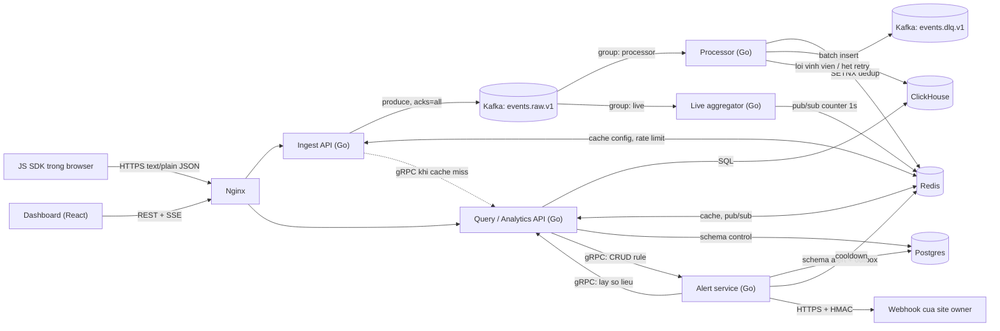
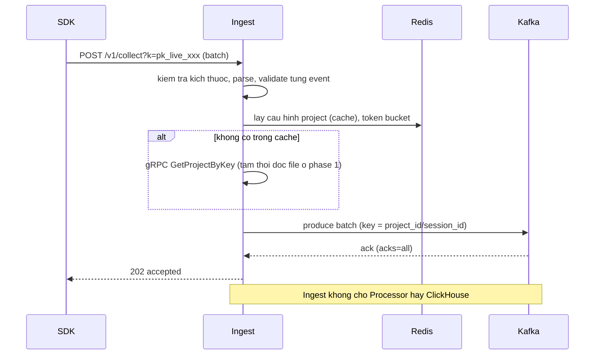

# 02. Kiến trúc

## 1. Nguyên tắc

- Kiến trúc hướng microservices nhưng **tách dần**: tên service và ranh giới rõ từ đầu, một số trách nhiệm tạm thời ở chung service (ADR-017).
- Đường ghi dữ liệu (ingest) tách khỏi đường đọc (query). Ingest không bao giờ chờ cơ sở dữ liệu phân tích.
- Giao tiếp bất đồng bộ qua Kafka cho dữ liệu, đồng bộ qua gRPC cho truy vấn cấu hình và số liệu giữa các service, REST và SSE cho trình duyệt.
- Mỗi service **sở hữu dữ liệu của mình**. Service khác không đọc thẳng cơ sở dữ liệu đó.

## 2. Sơ đồ container

## 3. Trách nhiệm từng service

| Service (repo) | Trách nhiệm | Sở hữu dữ liệu | Phụ thuộc đồng bộ | Phụ thuộc bất đồng bộ | Đơn vị scale |
|---|---|---|---|---|---|
| Ingest (`ingest`) | Nhận HTTP, validate, rate limit, enrich nhẹ (thời gian nhận), publish Kafka | Không (stateless) | Redis, gRPC tới Query (cache miss) | Kafka (ghi) | Số instance theo RPS |
| Processor (`processor`) | Consume, enrich nặng (UA, geo), dedup, batch ghi ClickHouse, retry, DLQ; binary thứ hai: live aggregator | Bảng `events` và aggregate trong ClickHouse (ghi) | ClickHouse, Redis | Kafka (đọc, ghi DLQ) | Số consumer, tối đa bằng số partition |
| Query (`query`) | REST + SSE cho dashboard, truy vấn analytics, auth, quản lý project/API key, gRPC nội bộ | Schema `control` trong Postgres, đọc ClickHouse | ClickHouse, Postgres, Redis, gRPC tới Alert | Không | Số instance theo người dùng |
| Alert (`alert`) | Lưu rule, đánh giá định kỳ, state machine, cooldown, giao webhook | Schema `alert` trong Postgres (rule, state, outbox) | gRPC tới Query, Redis | Không | 1 leader đánh giá, N worker giao webhook |
| SDK (`sdk-js`) | Thu thập, batch, gửi | Không | HTTP tới Ingest | Không | Không áp dụng |
| Dashboard (`dashboard`) | Hiển thị | Không | REST/SSE tới Query | Không | CDN/Nginx |
| Contracts (`contracts`) | Định nghĩa Protobuf, gRPC, OpenAPI | Không | Không | Không | Không |

Ghi chú: Query gồm cả **control plane** (user, project, API key). Đây là quyết định có chủ đích, xem ADR-017.

## 4. Luồng chính

### 4.1 Ingestion

### 4.2 Xử lý và lưu trữ

1. Processor poll theo consumer group, giải mã Protobuf.
2. Enrich: user agent, quốc gia, host referrer, định danh khách ẩn danh.
3. Dedup: bước lọc nhanh bằng Redis `SET NX` theo `event_id`, cộng token dedup theo batch khi insert ClickHouse (xem [05](05-contracts.md), ADR-020).
4. Gom batch theo kích thước hoặc thời gian (ví dụ 10.000 dòng hoặc 1 giây), insert ClickHouse.
5. **Chỉ commit offset sau khi insert thành công** (at-least-once).
6. Lỗi tạm thời: giữ nguyên offset, dừng partition và thử lại với backoff. Lỗi vĩnh viễn (không giải mã được, vi phạm schema): đẩy vào `events.dlq.v1` kèm lý do rồi tiếp tục.

### 4.3 Truy vấn và real-time

- Lịch sử: Query đọc materialized view `AggregatingMergeTree` (theo phút, giờ), cache Redis vài giây.
- Real-time: Live aggregator đọc cùng topic bằng consumer group riêng, cộng counter theo cửa sổ 1 giây, `PUBLISH` lên Redis. Query subscribe và đẩy ra SSE đúng project mà người dùng sở hữu.

### 4.4 Cảnh báo

1. Alert đánh giá mỗi 10-30 giây: gọi gRPC `QueryService.GetMetric` để lấy số liệu cửa sổ gần nhất và baseline.
2. State machine mỗi rule: `OK -> PENDING -> FIRING -> RESOLVED`.
3. Khi chuyển sang `FIRING` và hết cooldown: ghi bản ghi vào **outbox** trong cùng transaction với cập nhật state.
4. Worker giao webhook đọc outbox, ký HMAC, gửi, retry theo backoff, cập nhật kết quả.

## 5. Ma trận giao tiếp

| Từ | Tới | Cơ chế | Lý do |
|---|---|---|---|
| SDK | Ingest | HTTP | Tích hợp dễ, `sendBeacon` |
| Dashboard | Query | REST + SSE | Trình duyệt tương thích tốt |
| Ingest | Processor | Kafka | Bất đồng bộ, chịu tải, có đệm |
| Ingest | Query (control) | gRPC | Contract rõ, hiệu quả; chỉ khi cache miss |
| Alert | Query | gRPC | Lấy số liệu, không chạm ClickHouse trực tiếp |
| Query | Alert | gRPC | CRUD rule từ dashboard |
| Processor | ClickHouse | Driver native | Insert batch |
| Mọi service | Redis | RESP | Cache, rate limit, dedup, pub/sub |

Ingest **không** gọi gRPC tới Processor rồi chờ. Đó là cách làm sai vì kéo độ trễ và độ khả dụng của xử lý vào đường ghi.

## 6. Failure modes

| Sự cố | Hành vi mong muốn | Tác động |
|---|---|---|
| Kafka không khả dụng | Ingest mở circuit breaker, trả `503` kèm `Retry-After`. SDK giữ batch và retry có jitter | Dữ liệu chưa nhận bị trì hoãn ở client, không mất trong giới hạn bộ đệm SDK |
| ClickHouse chậm hoặc down | Processor dừng consume các partition, backoff. Kafka giữ dữ liệu trong thời gian retention | Lag tăng, không mất. Cảnh báo theo lag |
| Redis down | Ingest dùng cache trong bộ nhớ (stale-while-revalidate) và limiter cục bộ. Processor bỏ qua lọc Redis, dựa vào token dedup của ClickHouse | Giới hạn rate kém chính xác tạm thời. Cho phép trùng nhỏ, aggregate cần đối chiếu |
| Query/Postgres down | Ingest dùng cấu hình project đã cache tới hết TTL. Key chưa biết: `503` | Project mới tạm chưa nhận được event |
| Processor crash | Rebalance, replay từ offset đã commit | Có thể giao lại, idempotency chặn trùng |
| Alert crash | State và outbox trong Postgres, khởi động lại tiếp tục | Trễ cảnh báo |
| Webhook đích lỗi | Retry backoff, hết lượt đánh dấu `failed`, hiển thị trên dashboard | Không chặn hệ thống |
| Một partition nóng | Cảnh báo lag theo partition, xem lại partition key | Giảm throughput cục bộ |

## 7. Góc nhìn triển khai

- **Dev:** Docker Compose một máy, một broker Kafka, một ClickHouse, một Redis, một Postgres, Nginx, Prometheus, Grafana, Kafka UI.
- **Prod-like (tuỳ chọn):** nhiều instance ingest và processor sau Nginx hoặc load balancer; Kafka 3 broker; ClickHouse replicated. Ghi nhận khoảng cách giữa dev và prod trong `docs/BENCHMARKS.md`.
- Mỗi service đóng gói thành image, đẩy lên GHCR, cấu hình bằng biến môi trường (12-factor).
